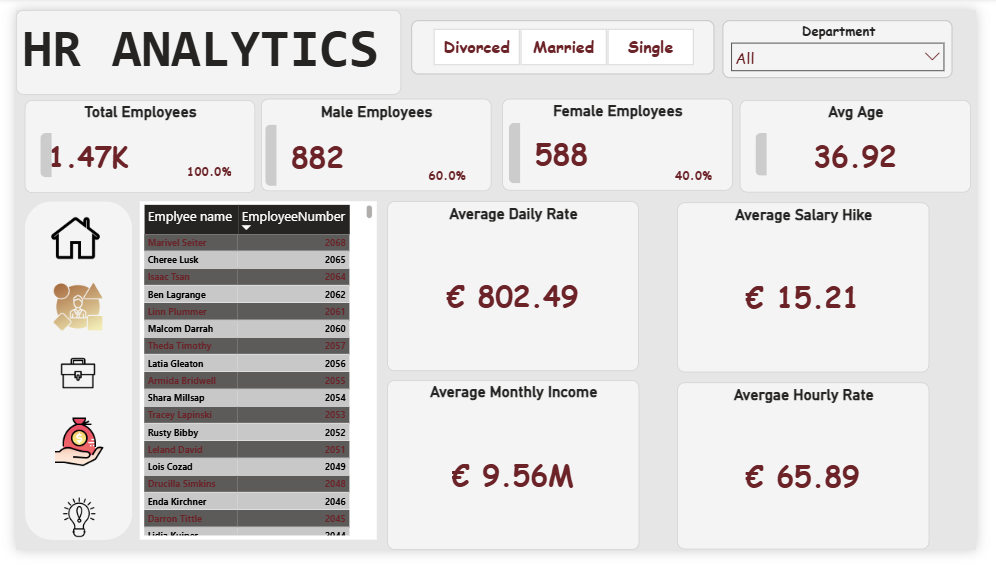
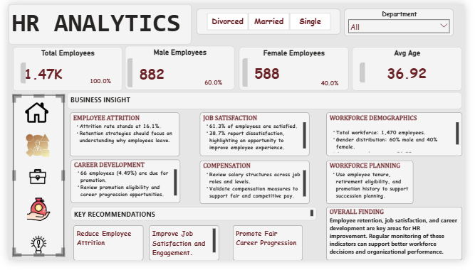

# HR Analytics Dashboard | Power BI

## Project Overview

This project explores employee and workforce data using Microsoft Power BI to identify trends in employee demographics, attrition, job satisfaction, compensation, promotion opportunities, and workforce planning.

The dashboard transforms employee data into interactive visualizations and business insights that can support data-driven human resource decisions.

## Business Objectives

- Analyze workforce size and employee demographics.
- Examine employee attrition and retention patterns.
- Evaluate employee job satisfaction.
- Review compensation indicators across the workforce.
- Investigate promotion opportunities and employee career progression.
- Support workforce planning and succession management.

## Tools Used

- Microsoft Power BI
- Power Query for data preparation, where applicable
- DAX for calculated measures, where applicable
- Data visualization and business analysis

## Dashboard Pages

### 1. Workforce Overview
Summarizes total employees, gender distribution, average age, and other workforce indicators.

### 2. Employee Profile
Explores employee characteristics and relevant workforce information.

### 3. Salary Analysis
Presents compensation indicators, including income, daily rates, hourly rates, and salary increases.

### 4. Company Details
Examines employee tenure, job levels, promotion history, overtime, and retirement-related indicators.

### 5. Business Insights and Key Findings
Summarizes key findings and provides recommendations for employee retention, job satisfaction, compensation reviews, career development, and workforce planning.

## Key Findings

- The workforce contains approximately 1,470 employees.
- Male employees account for 60% of the workforce, while female employees account for 40%.
- The average employee age is approximately 36.92 years.
- The dashboard indicates an attrition rate of approximately 16.1%.
- Approximately 61.3% of employees are satisfied, while 38.7% are not satisfied.
- A total of 66 employees are identified as due for promotion, representing 4.49%.

## Business Recommendations

- Investigate the factors associated with employee attrition.
- Improve employee engagement and satisfaction.
- Review compensation measures and salary structures.
- Promote transparent career progression opportunities.
- Use employee tenure and retirement indicators to support succession planning.

## Skills Demonstrated

- Data analysis
- Data visualization
- Dashboard development
- Business intelligence
- KPI reporting
- Translating data into actionable business recommendations

## Project Files

This repository contains dashboard screenshots, the Power BI report where available, and project documentation.

## Conclusion

This project demonstrates how Power BI can be used to analyze workforce data, identify HR trends, and communicate business insights that support informed organizational decision-making.

## 📊 Dashboard Preview

### 1. Home Page

### 2. Company Details

### 3. Employee Profile

### 4. Salary Analysis

### 5. Business Insights

